# IFNMG • Sistema Web de Avaliação Atitudinal
## Arquitetura de Informação, Mapa de Navegação e Salvaguardas Pedagógicas

> **Projeto Institucional:** Avaliação Atitudinal e Socioemocional Formativa  
> **Instituição:** Instituto Federal do Norte de Minas Gerais (IFNMG)  
> **Versão:** 1.0 (Produção / Homologação Pedagógica)  
> **Alinhamento Normativo:** BNCC (Competências Gerais Socioemocionais), LGPD (Lei 13.709/2018 - Arts. 11, 14 e 20), Modelo MTSS (*Multi-Tiered System of Supports*) e Referenciais Internacionais de Clima Escolar.

---

## 1. Visão Geral da Arquitetura e Filosofia do Sistema

O **Sistema Web de Avaliação Atitudinal do IFNMG** foi concebido a partir de um paradigma estritamente formativo, emancipatório e restaurativo, rompendo com lógicas históricas de rotulação, punição ou ranqueamento algorítmico de estudantes.

A arquitetura organiza-se em três ecossistemas simbióticos de experiência do usuário:
1. **Ecossistema Docente (*Mobile-First / Fast-Capture*):** Otimizado para salas de aula reais de até 40 estudantes, viabilizando o registro observável e padronizado em **menos de 10 segundos** através da **Regra dos 3 Toques** (Dimensão BNCC $\to$ Natureza Pedagógica $\to$ Chip de Evidência Objetiva).
2. **Ecossistema Gestão e Coordenação (*Desktop Analytical Cockpit*):** Painel analítico de alta densidade voltado a intervenções pedagógicas preventivas, integrando o **Alerta Precoce MTSS** (Camadas Universal, Focalizada e Intensiva), o **Heatmap Sociométrico de Clima Escolar** e a **Central Restaurativa de Mediação** (com governança de SLA de 48h).
3. **Ecossistema Estudante & Família (*Responsive & Restorative Portal*):** Interfaces orientadas à autoeficácia, transparência e acolhimento. Proíbem explicitamente qualquer exibição de tabelas classificatórias (*rankings*) entre pares, provendo radares de competências, autoavaliações metacognitivas guiadas e canal bidirecional de diálogo e contestação com protocolo institucional auditável.

---

## 2. Mapa Completo de Navegação e Transições de Interface (Mermaid)

O diagrama a seguir consolida toda a topologia de navegação do sistema, integrando fluxos de entrada, rotas principais, transições contextuais, acionamento de modais e pontos de mediação pedagógica entre os três perfis.

```mermaid
flowchart TD
    %% Nós de Início e Autenticação
    ROOT(["Portal IFNMG AvaliaAtitude<br/>Autenticação Federada / Gov.br"])
    
    %% M00: Triagem de Perfil
    M00["[M00] Hub de Boas-Vindas & Seleção de Perfil<br/>Docente | Gestor | Estudante | Família"]
    ROOT --> M00

    %% ==========================================
    %% TRILHA 1: PERFIL DOCENTE (Mobile-First)
    %% ==========================================
    subgraph PERFIL_DOCENTE ["Trilha Docente (Mobile-First / Coleta em Sala)"]
        direction TB
        M01["[M01] Minhas Turmas<br/>Grade de Turmas Ativas (Ex: 9º Ano B, 3º Info)"]
        M02["[M02] Chamada Atitudinal & Lista de Estudantes<br/>Carrossel de Dimensões | Busca Rápida<br/>Casos: Lucas Mendes Silva & Beatriz Santos"]
        
        M03["[M03] Registro Rápido dos 3 Toques<br/>1. Dimensão BNCC<br/>2. Natureza (Formativa / Atenção / Neutra)<br/>3. Chip de Evidência Observável"]
        
        MODAL_EXTRA{"[Modal Extra]<br/>Evidência Complementar<br/>Áudio Rápido | Nota | Foto"}
        
        M04["[M04] Radar e Prontuário do Docente<br/>Balanço Socioemocional | Histórico Temporal<br/>Gatilho de Autoavaliação"]
    end

    M00 -- "Papel: Professor" --> M01
    M01 -- "Selecionar Turma" --> M02
    M02 -- "Toque no Estudante (A/B)" --> M03
    M03 -- "Toque 1, 2 e 3 + Salvar Imediato (<10s)" --> M02
    M03 -. "Opção: + Contexto" .-> MODAL_EXTRA
    MODAL_EXTRA -. "Salvar Anexo" .-> M03
    M02 -- "Ver Prontuário / Radar Individual" --> M04
    M04 -- "Voltar à Lista" --> M02

    %% ==========================================
    %% TRILHA 2: GESTÃO E COORDENAÇÃO (Desktop)
    %% ==========================================
    subgraph PERFIL_GESTAO ["Trilha Gestão & Coordenação Pedagógica (Desktop Cockpit)"]
        direction TB
        D01["[D01] Alerta Precoce MTSS (Cockpit Analítico)<br/>Camada 1 (Universal 82%) | Camada 2 (Focalizado 13%) | Camada 3 (Intensivo 5%)"]
        D02["[D02] Clima Escolar Finlandês (Heatmap)<br/>Matriz Sociométrica de Turmas | Dimensões BNCC"]
        D03["[D03] Prontuário 360º do Estudante<br/>Lucas Mendes Silva & Beatriz Santos<br/>Heteroavaliação x Autoavaliação"]
        D04["[D04] Central de Mediação & Casos Críticos<br/>Fila de Contestações | Triagem Restaurativa | SLA 48h"]
        
        MODAL_INTERV{"[Modal Intervenção MTSS]<br/>Prescrição de Apoio Focalizado<br/>Ações, Metas e Responsáveis"}
        MODAL_RESOLU{"[Modal Resolução SLA 48h]<br/>Homologação de Parecer Devolutivo<br/>Protocolo #CONT-2026-89"}
        MODAL_RELAT{"[Modal Síntese Institucional]<br/>Relatório para Conselho de Classe<br/>Anonimizado / Foco Formativo LGPD"}
    end

    M00 -- "Papel: Coordenação / Gestor" --> D01
    D01 <--> D02
    D01 <--> D03
    D01 <--> D04
    D02 --> D03
    
    D01 -- "Prescrever Plano MTSS" --> MODAL_INTERV
    D03 -- "Adicionar Intervenção Pedagógica" --> MODAL_INTERV
    MODAL_INTERV -. "Salvar Intervenção" .-> D03

    D04 -- "Julgar e Homologar Parecer" --> MODAL_RESOLU
    MODAL_RESOLU -. "Parecer Deferido/Acolhido" .-> D04

    D03 -- "Exportar Síntese para Conselho" --> MODAL_RELAT
    D01 -- "Relatório Executivo de Turma" --> MODAL_RELAT

    %% ==========================================
    %% TRILHA 3: ESTUDANTE & FAMÍLIA (Responsivo)
    %% ==========================================
    subgraph PERFIL_COMUNIDADE ["Trilha Estudante & Família (Transparência Formativa)"]
        direction TB
        M05["[M05] Painel Formativo do Estudante<br/>Radar de Competências | Percurso Temporal<br/>Linguagem Encorajadora (Sem Rankings)"]
        M06["[M06] Autoavaliação Guiada por Rubricas<br/>Escala Likert Formativa | Reflexão Metacognitiva"]
        
        M07["[M07] Espaço Acolhedor da Família<br/>Frequência | Síntese Formativa Quinzenal<br/>Orientações Pedagógicas de Apoio em Casa"]
        
        M08["[M08] Canal de Diálogo & Contestação<br/>Justificativa Médica / Pedagógica<br/>Upload de Atestado | Disparo SLA 48h"]
        M09["[M09] Protocolo SLA 48h & Parecer Homologado<br/>Tracking em Tempo Real (#CONT-2026-89)<br/>Acolhimento da Coordenação"]
    end

    M00 -- "Papel: Estudante (Lucas)" --> M05
    M05 -- "Iniciar Autoavaliação do Bimestre" --> M06
    M06 -- "Concluir e Submeter Reflexão" --> M05
    M05 -- "Dúvida ou Ponto de Discordância" --> M08

    M00 -- "Papel: Responsável Legal" --> M07
    M07 -- "Solicitar Revisão ou Justificar Ocorrência" --> M08
    M08 -- "Submeter Contestação / Atestado" --> M09
    M07 -- "Consultar Protocolos Anteriores" --> M09

    %% ==========================================
    %% INTERLIGAÇÕES SISTÊMICAS ENTRE PERFIS
    %% ==========================================
    M03 -. "Registro Alimenta Prontuário" .-> D03
    M06 -. "Autoavaliação Alimenta Prontuário" .-> D03
    M08 ==> |"Gera Notificação de Mediação"| D04
    MODAL_RESOLU ==> |"Atualiza Parecer Homologado"| M09
    MODAL_RESOLU -. "Ajusta Registro Contestado" .-> M04

    %% Estilização Semântica de Nós
    classDef mobile fill:#F0FDF4,stroke:#16A34A,stroke-width:2px,color:#065F46;
    classDef desktop fill:#EFF6FF,stroke:#2563EB,stroke-width:2px,color:#1E40AF;
    classDef family fill:#FFFBEB,stroke:#D97706,stroke-width:2px,color:#92400E;
    classDef modal fill:#FDF4FF,stroke:#9333EA,stroke-width:2px,stroke-dasharray: 5 5,color:#701A75;
    classDef root fill:#F8FAFC,stroke:#475569,stroke-width:3px,color:#0F172A;

    class ROOT,M00 root;
    class M01,M02,M03,M04 mobile;
    class D01,D02,D03,D04 desktop;
    class M05,M06,M07,M08,M09 family;
    class MODAL_EXTRA,MODAL_INTERV,MODAL_RESOLU,MODAL_RELAT modal;
```



---

## 3. Matriz de Permissões, Governança RACI e Salvaguardas LGPD

O tratamento de dados atitudinais e comportamentais de estudantes (majoritariamente adolescentes no ensino técnico integrado) envolve **dados pessoais e dados sensíveis** sob a égide da **Lei Geral de Proteção de Dados (Lei 13.709/2018 - Arts. 11, 14 e 20)** e do **Estatuto da Criança e do Adolescente (ECA - Lei 8.069/1990)**.

### 3.1. Papéis de Acesso Definidos
- **[ADM-TI]** Administrador de Sistemas & Infraestrutura IFNMG.
- **[GESTOR]** Equipe Diretiva, Coordenação Pedagógica e Orientação Educacional.
- **[DOCENTE]** Professores com atribuição ativa nas respectivas turmas/disciplinas.
- **[ESPEC-NAPNE]** Profissionais de Educação Especial (NAPNE), Psicologia e Serviço Social.
- **[ESTUDANTE]** Discente matriculado (Titular dos dados).
- **[FAMÍLIA]** Responsáveis legais formalmente registrados no sistema acadêmico.

### 3.2. Matriz Operacional de Permissões & Salvaguardas LGPD

| Funcionalidade / Repositório de Dados | ADM-TI | GESTOR | DOCENTE | ESPEC-NAPNE | ESTUDANTE | FAMÍLIA | Base Legal & Salvaguarda LGPD |
| :--- | :---: | :---: | :---: | :---: | :---: | :---: | :--- |
| **Visão Agregada da Turma (Heatmap / Clima)** | Auditoria | Leitura/Export | Leitura (Sua Turma) | Leitura | Bloqueado | Bloqueado | Dado anonimizado/agregado. Preserva a turma sem expor indivíduos. |
| **Registro 3 Toques (Comportamento)** | Bloqueado | Leitura | Gravação (Sua Turma) | Leitura | Bloqueado | Bloqueado | Finalidade pedagógica estrita; vedada autuação de quem não leciona. |
| **Prontuário Individual 360º** | Auditoria | Leitura/Escrita | Leitura (Sua Turma) | Leitura/Escrita | Bloqueado (Vê M05) | Bloqueado (Vê M07) | Sigilo pedagógico multiprofissional. |
| **Laudos de Saúde / Atestados Médicos** | Bloqueado | Leitura | Bloqueado | Leitura/Validação | Próprio | Dependente | **Dado Sensível (Art. 11 LGPD)**. Docente vê apenas o efeito pedagógico. |
| **Submissão de Autoavaliação Metacognitiva** | Bloqueado | Leitura | Leitura | Leitura | Gravação (Próprio) | Bloqueado | Metacognição pessoal inviolável do estudante titular. |
| **Abertura de Contestação / Diálogo** | Bloqueado | Leitura | Notificado | Leitura | Gravação (Próprio) | Gravação (Dep.) | Direito ao contraditório pedagógico e escuta familiar. |
| **Homologação Devolutiva SLA 48h** | Bloqueado | Deliberação | Consultado | Consultado | Leitura | Leitura | **Art. 20 LGPD:** Vedada decisão exclusivamente automatizada. |
| **Prescrição de Intervenção MTSS** | Bloqueado | Deliberação | Coparticipante | Deliberação | Bloqueado | Notificado | Intervenção de suporte socioemocional individualizada. |
| **Rankings Comparativos Públicos** | **PROIBIDO** | **PROIBIDO** | **PROIBIDO** | **PROIBIDO** | **PROIBIDO** | **PROIBIDO** | **Violação Ética Institucional.** Totalmente extirpado da plataforma. |
| **Retificação / Exclusão de Registro Histórico** | Log Técnico | Deliberação | Requisitante | Consultado | Requisitante | Requisitante | **Direitos do Titular (Art. 18 LGPD).** Registro auditável de alterações. |

### 3.3. Matriz de Responsabilidade RACI

| Atividade do Fluxo Pedagógico | ADM-TI | GESTOR | DOCENTE | ESPEC-NAPNE | ESTUDANTE | FAMÍLIA |
| :--- | :---: | :---: | :---: | :---: | :---: | :---: |
| **Registro de evidência em sala de aula** | I | I | **R / A** | C | I | I |
| **Adição de nota contextual sensível (Áudio/Foto)** | I | C | **R** | C | I | I |
| **Classificação de Nível MTSS (Camadas 1, 2, 3)** | I | **A** | C | **R** | I | I |
| **Preenchimento da autoavaliação bimestral** | I | I | C | I | **R / A** | I |
| **Abertura de pedido de diálogo com atestado** | I | I | I | I | **R** | **R / A** |
| **Análise e homologação de contestação (SLA 48h)** | I | **R / A** | C | C | I | I |
| **Condução de mediação restaurativa presencial** | I | **A** | C | **R** | C | C |
| **Geração de síntese para Conselho de Classe** | I | **R / A** | C | C | I | I |

*Legenda RACI: **R** = Responsible (Executa); **A** = Accountable (Responde formalmente / Aprova); **C** = Consulted (Consultado tecnicamente); **I** = Informed (Notificado / Informado).*

---

## 4. Especificação Detalhada dos Estados de Interface

A interface do AvaliaAtitude implementa um sistema de estados rígido e consistente para garantir previsibilidade, clareza cognitiva e alta acessibilidade em todas as circunstâncias operacionais.

```
+---------------------------------------------------------------------------------------------------+
| GUIA VISUAL DE ESTADOS DE INTERFACE                                                               |
+------------------+-----------------------+-----------------------+--------------------------------+
| Estado           | Efeito Visual         | Indicadores Acessíveis| Feedback Interativo            |
+------------------+-----------------------+-----------------------+--------------------------------+
| Default          | Border: 1px gray-200  | Contraste texto >= 7:1| Cursor pointer em clicáveis    |
| Hover            | Border: 1px gray-400  | Shadow: 0 2px 8px     | Transição suave 150ms ease-out |
| Selected/Active  | Border: 2px primary   | Checkmark / Pill Dark | Background tonal leve (5% tint)|
| Focus / Teclado  | Ring: 2px primary     | Outline-offset: 2px   | Salto de foco visível TAB      |
| Error / Alert    | Border: 1.5px alert   | Ícone svg + mensagem  | Cor + Ícone + Texto (WCAG 1.4) |
| Empty State      | Ilustração neutra     | Texto instrutivo      | Botão de ação (CTA) visível    |
| Loading State    | Skeleton animado      | aria-busy="true"      | Layout preservado sem saltos   |
+------------------+-----------------------+-----------------------+--------------------------------+
```

### 4.1. Tabela de Tokens e Comportamentos por Componente

| Componente | Estado Default | Estado Hover | Estado Selected / Active | Estado Focus (A11y) | Estado Error / Alerta | Estado Empty / Loading |
| :--- | :--- | :--- | :--- | :--- | :--- | :--- |
| **Chip de Evidência (M03)** | Fundo `#F3F4F6`, texto `#374151`, raio 20px, altura 32px | Fundo `#E5E7EB`, escala 1.02x sutil | Fundo `#15803D`, texto `#FFFFFF`, ícone de check | Contorno `#16A34A` de 2px com offset de 2px | Borda vermelha pontilhada caso incompatível | Skeleton cinza pulsante 1s |
| **Card de Estudante (M02/D03)** | Fundo `#FFFFFF`, borda `#E5E7EB`, raio 8px, padding 12px | Fundo `#F9FAFB`, borda `#D1D5DB`, elevação `0 2px 4px rgba(0,0,0,0.05)` | Borda lateral esquerda 4px `#15803D` ou `#D97706` | Borda azul contínua de 2px via Teclado | Badge âmbar "Atenção" caso queda de pontualidade | Mensagem amigável "Nenhum estudante com esse filtro" |
| **Seletor de Natureza (M03)** | 3 Cards (Formativa, Atenção, Neutra), borda `#E5E7EB` | Borda ganha cor temática correspondente | Borda 2px e fundo 10% da cor da natureza | Contorno preto `#000000` acessível de 2px | N/A (Opção padrão sempre selecionada) | N/A |
| **Linha de Alerta MTSS (D01)** | Fundo branco, badge de camada (C1, C2, C3) | Fundo `#F8FAFC`, ação secundária destaca-se | Destaque com borda `#2563EB` ao abrir detalhes | Navegação por setas com `focus-visible` | Linha vermelha clara `#FEF2F2` para Camada 3 | Carregando tabela via 4 linhas skeleton |
| **Card de Protocolo (M09/D04)** | Fundo `#FFFFFF`, borda `#E5E7EB`, status visível | Cursor pointer, borda `#94A3B8` | Seção expansível aberta com parecer completo | Salto direto via `aria-expanded` | Badge vermelho caso prazo do SLA esteja < 6 horas | Ilustração de acolhimento "Sem contestações pendentes" |

---

## 5. Regras de Usabilidade e Salvaguardas Pedagógicas

### 5.1. Regra de Ouro dos 3 Toques do Docente (< 10 Segundos)
1. **Problema Prático Resolvido:** Professores do ensino técnico possuem turmas de 35 a 40 discentes e intervalos curtos entre atividades práticas de laboratório e aulas teóricas. Sistemas burocráticos tradicionais exigem preenchimento de parágrafos descritivos e árvores profundas de menus, inviabilizando o registro em tempo real.
2. **Arquitetura da Solução:**
   - **Toque 1 (Dimensão):** O docente toca na dimensão predominante (ex: Cooperação, Autogestão, Engajamento ou Resiliência).
   - **Toque 2 (Natureza):** O docente define o sentido pedagógico (Formativa / Fortaleza, Ponto de Atenção / Desenvolvimento ou Neutra).
   - **Toque 3 (Evidência Objetiva):** O docente clica no chip de comportamento observável pré-padronizado (ex: *"Apoio ativo aos colegas"* ou *"Cumprimento de prazos"*).
   - **Disparo Automático:** O sistema salva instantaneamente ao 3º toque e retorna à chamada atitudinal com confirmação tátil/sonora sutil (Toast não-intrusivo de 1,2s).
   - **Evidência Contextual Opcional:** Caso o professor queira gravar um áudio de 15 segundos ou tirar uma foto do caderno/projeto, o botão `[+ Contexto]` abre um modal modal não-bloqueante que não interrompe a contagem rápida.

### 5.2. SLA Formal de 48 Horas Úteis para Contestação e Diálogo
- **Garantia Constitucional e Formativa:** A avaliação formativa não pode ser unilateral. Ao estudante e à sua família é assegurado o direito ao contraditório pedagógico.
- **Mecanismo Operacional:**
  1. A família ou estudante submete pedido de diálogo pelo portal (ex: justificando sonolência decorrente de efeito colateral de medicamento antialérgico, com anexo médico em PDF).
  2. O sistema gera automaticamente o número de protocolo com carimbo de tempo (*timestamp*) e inicia a contagem regressiva de **48 horas úteis**.
  3. A coordenação pedagógica recebe o alerta de prioridade no painel desktop `[D04] Central de Mediação`.
  4. O parecer devolutivo é formalizado pela coordenação (apoiada pelo NAPNE se necessário) com opção de acolhimento total, acolhimento com agendamento de escuta presencial ou esclarecimento pedagógico.
  5. Caso deferido, o registro contestado no radar docente é contextualizado retroativamente, impedindo que gere distorções no histórico do estudante.

### 5.3. Princípio da Não-Punição e Proibição de Ranqueamentos Públicos
- **Fundamentação Pedagógica (Vygotsky e BNCC):** A avaliação socioemocional destina-se a mapear a *Zona de Desenvolvimento Proximal* e subsidiar apoios empáticos, nunca punir, humilhar ou classificar discentes.
- **Diretrizes Técnicas Invioláveis de Interface:**
  1. **Ausência Total de Placares de Líderes (*Leaderboards*):** É terminantemente proibido qualquer ranqueamento ordinal (*"1º lugar da turma"*, *"último do bimestre"*).
  2. **Radares Individuais Privados:** O estudante Lucas Mendes Silva visualiza apenas a sua própria evolução temporal em relação a si mesmo (autoeficácia), nunca a média ordinal comparativa com seus colegas de sala.
  3. **Linguagem Acolhedora:** Substituição de jargões punitivos (*"Indisciplinado"*, *"Infrator"*) por nomenclaturas de desenvolvimento formativo (*"Competência em Expansão"*, *"Ponto de Apoio Necessário"*, *"Fortaleza Consolidada"*).
  4. **Proteção do Clima da Turma:** No nível da gestão (`[D02] Clima Escolar`), os mapas de calor exibem apenas agregados estatísticos anônimos por eixo pedagógico, impedindo a exposição pública de estudantes em vulnerabilidade.

### 5.4. Acessibilidade e Inclusão Universal (WCAG 2.1 AA)
- Contraste de cor mínimo de 4.5:1 para texto normal e 3:1 para componentes de interface.
- Tamanho mínimo de alvo de toque (*touch target*) de **48x48 pixels** em telas móveis, garantindo acionamento confortável mesmo em smartphones compactos.
- Semântica completa via atributos ARIA (`aria-live`, `aria-expanded`, `role="alert"`) para permitir operação autônoma por leitores de tela para discentes e docentes com deficiência visual.
- Ausência de dependência exclusiva de cores: todo sinal cromático (verde, âmbar, vermelho) é invariavelmente acompanhado de um ícone gráfico e de um texto explícito.

---

## 6. Mapeamento dos Dois Casos de Uso Reais (Mockups Operacionais)

### 6.1. Caso do Estudante A: Lucas Mendes Silva (9º Ano B)
- **Perfil Diagnóstico:** Estudante de alta colaboração em equipe, com queda pontual de rendimento e registro de sonolência no primeiro horário das aulas.
- **Fluxo no Sistema:**
  1. *Docente:* Registra ponto de atenção em *Autogestão / Pontualidade* com o chip *"Dificuldade de concentração inicial"*.
  2. *Família (Mãe Mariana Mendes):* Acessa `[M07] Espaço da Família`, visualiza o relatório quinzenal e aciona o canal `[M08] Abrir Diálogo`.
  3. *Contestação:* Envia atestado médico comprovando início de tratamento alérgico com anti-histamínico gerador de sonolência involuntária. Sistema gera o Protocolo `#CONT-2026-89`.
  4. *Gestão:* A coordenação acessa `[D04] Central de Mediação`, analisa o protocolo dentro do prazo de 48h e homologa o parecer devolutivo via `[Modal Resolução]`, orientando os professores a acolherem o ritmo do discente nas primeiras semanas.
  5. *Resultado:* O protocolo no portal `[M09]` passa para o status **Homologado**, com a devolutiva transparente visível para a família e para o estudante.

### 6.2. Caso da Estudante B: Beatriz Santos Oliveira (9º Ano B)
- **Perfil Diagnóstico:** Estudante consistente nas dimensões interpessoais, porém com sobrecarga na entrega de relatórios laboratoriais cruzados.
- **Fluxo no Sistema:**
  1. *Estudante:* Ao preencher a `[M06] Autoavaliação Guiada`, pontua sua autogestão como *"Em Início"* e registra na reflexão metacognitiva: *"Estou com dificuldade de conciliar os relatórios de Química com os de Informática"*.
  2. *Docente:* Ao visualizar o prontuário no `[M04] Radar`, identifica a discrepância entre a boa cooperação e a autoavaliação aflita de autogestão.
  3. *Gestão:* O motor MTSS categoriza a estudante na **Camada 2 (Apoio Focalizado - Amarelo)** no painel `[D01]`.
  4. *Intervenção:* A pedagoga abre o `[Modal Intervenção MTSS]` e prescreve o plano de mentoria acadêmica de 4 semanas com oficina de planejamento de estudos pelo NAPNE.
  5. *Resultado:* Acompanhamento sistemático sem atribuição de notas baixas punitivas, fortalecendo a permanência e o êxito discente no IFNMG.

---

## 7. Conclusão e Próximos Passos de Integração

O presente artefato de arquitetura de informação e fluxos de navegação estabelece as diretrizes fundamentais para os protótipos interativos do **AvaliaAtitude**. Todos os componentes, modais e transições aqui descritos encontram correspondência direta nos arquivos implementados:
- Protótipo Mobile Docente, Aluno e Família: [prototipo_interativo_mobile.html](file:///home/felkng/Documents/faculdade/WEB/avaliacao_atitudinal/prototipo_interativo_mobile.html)
- Protótipo Desktop Gestão MTSS e Clima: [prototipo_interativo_desktop.html](file:///home/felkng/Documents/faculdade/WEB/avaliacao_atitudinal/prototipo_interativo_desktop.html)
